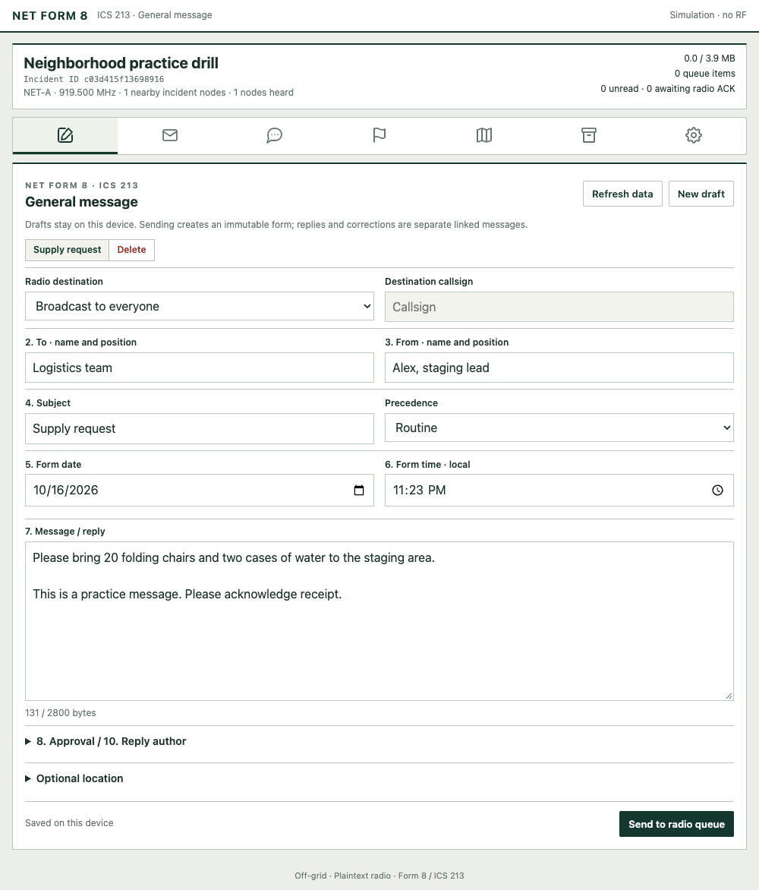
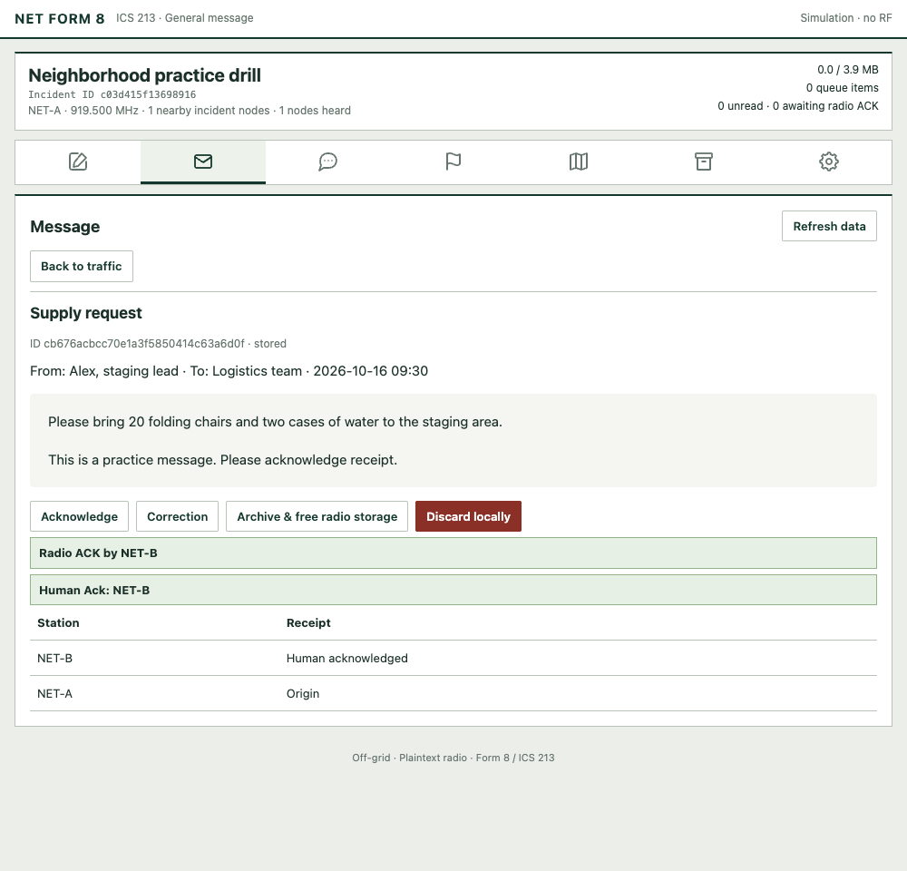
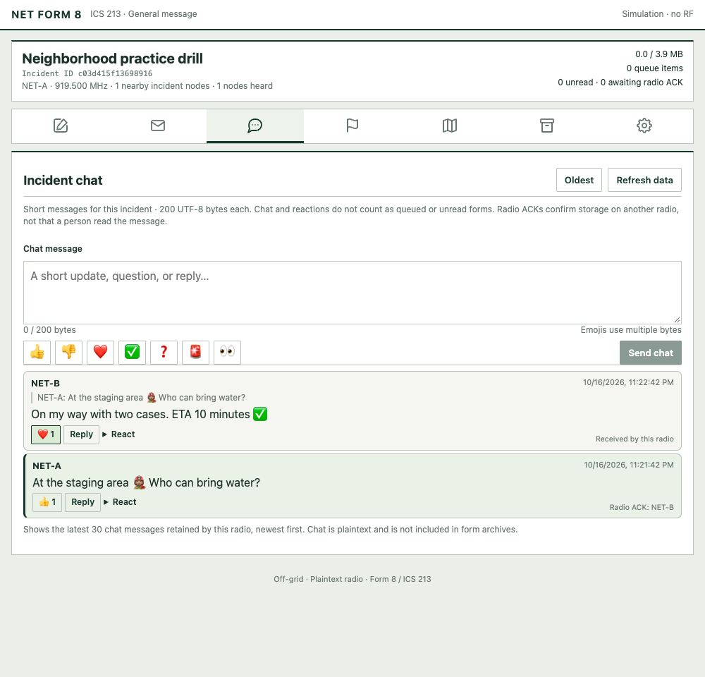
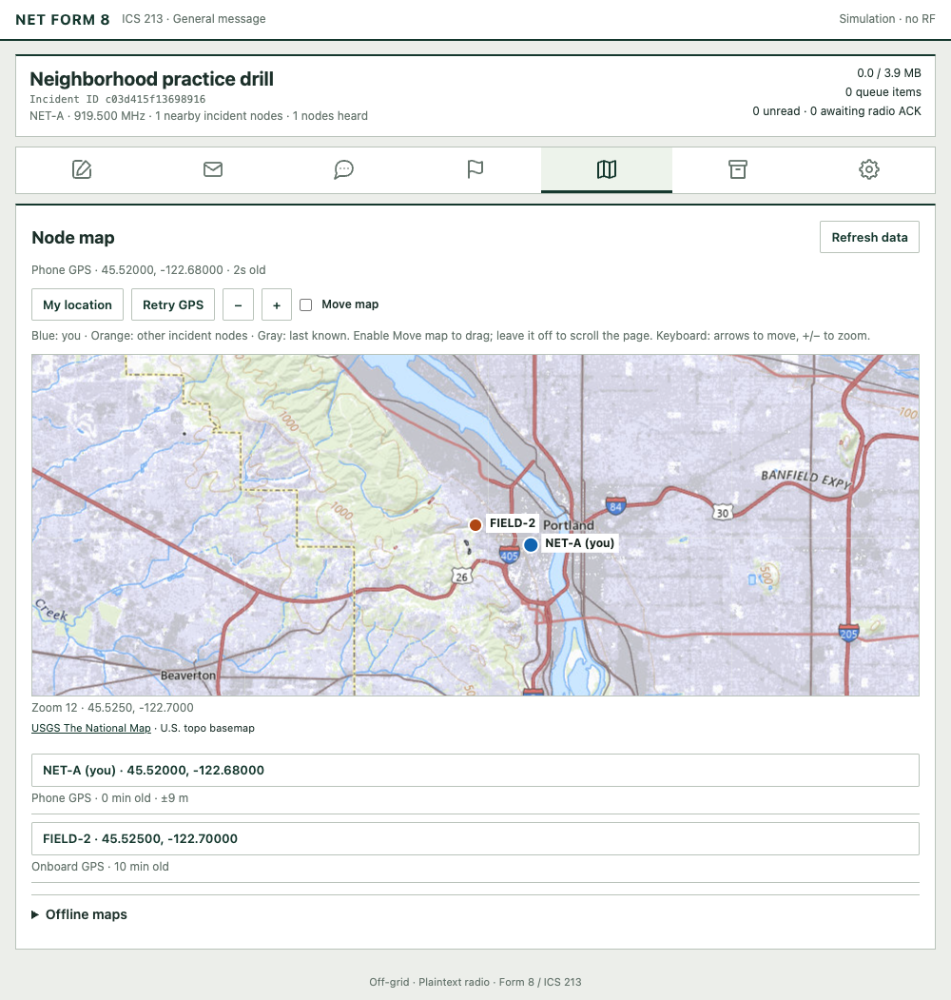

# Form8

Form8 exchanges **Portland NET Form 8 / ICS 213 messages and short chat messages over LoRa**, using a phone or laptop. ESP32 radios host a Wi-Fi webpage or connect to the Android app over paired Bluetooth; nRF52840 radios connect to the Android companion over Bluetooth or USB serial. Messaging works without internet or cell service after installation.

Forms support radio receipts, manual acknowledgments, replies, corrections, and device archives. Chat supports emoji, reactions, and replies. A map shows incident stations, with automatic GPS positioning, configurable position sharing, and downloadable U.S. topo maps for offline use. The interface fits a phone screen; on nRF radios, the app carries the interface and message storage.

Nine nRF52840 targets include RAK4631, WisMesh Tag, T-Echo, Heltec T114/T096, and Seeed T1000-E, Wio Tracker L1, Solar Node, and XIAO nRF52 Kit. ESP32 builds cover Heltec V3/V4, Seeed XIAO ESP32S3 with Wio-SX1262, LILYGO T3-S3, original ESP32 T-Beam, and T-LoRa/LoRa32 revisions; T-Beam BPF is experimental. **Radio traffic is plaintext and unauthenticated.** Form8 uses its own protocol and does not communicate with Meshtastic or MeshCore. Physical range and reliability still need testing.

**[Android & nRF setup](https://github.com/pdxlocations/form8/wiki/nRF52-and-Android) · [Install / update](https://form8.pdxlocs.com) · [Documentation & FAQ](https://github.com/pdxlocations/form8/wiki) · [Firmware releases](https://github.com/pdxlocations/form8/releases)**

## Screenshots

Example screens from the local simulator; these do not demonstrate an RF connection.

### Compose a form

### Read and acknowledge a message

### Incident chat

### Incident map

